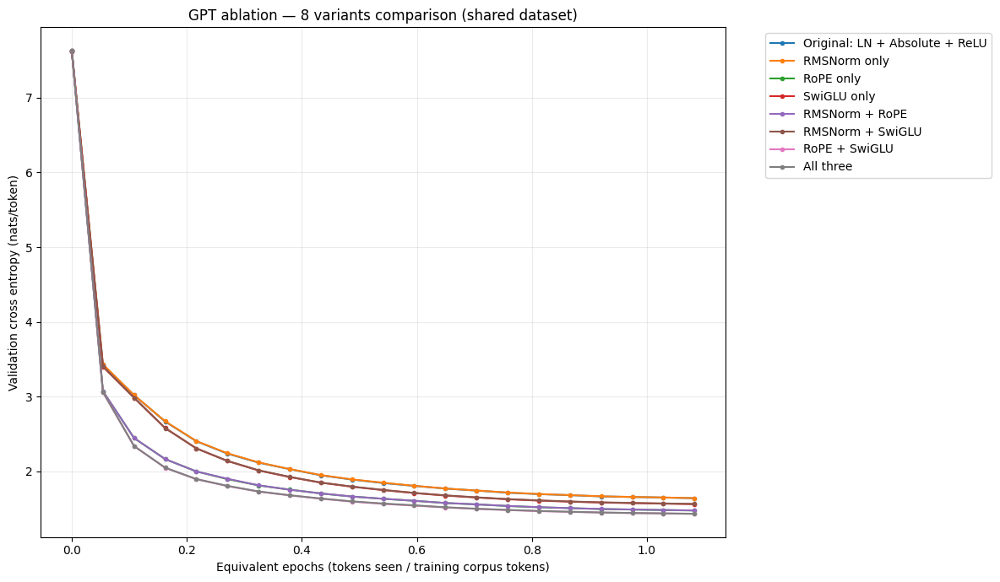
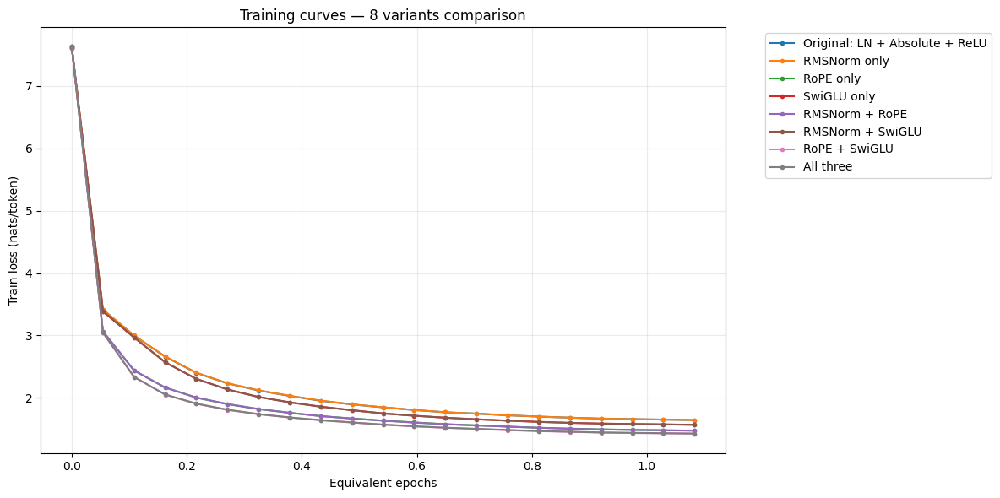
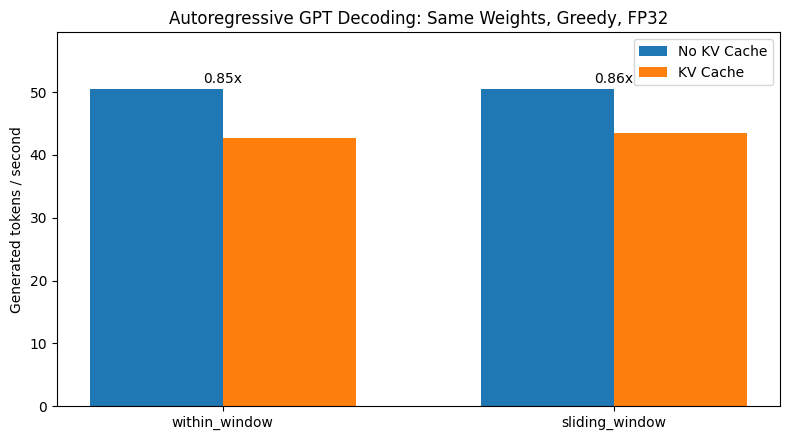

# GPT Architecture Ablations

从零实现 GPT，并在**相同的数据、参数预算、随机种子和训练步数**下，对比 LayerNorm / RMSNorm、绝对位置编码 / RoPE、ReLU FFN / SwiGLU 及其组合的效果。

> A from-scratch GPT ablation study on Chinese TinyStories: RMSNorm, RoPE and SwiGLU against the GPT-2-style baseline under a shared token budget, plus a separate KV-Cache inference benchmark. Notebooks are annotated in Chinese and run end-to-end on Google Colab.



## 结论速览

| 排名 | 配置 | Best Val Loss |
|---:|---|---:|
| 1 | RoPE + SwiGLU | **1.4331** |
| 2 | RMSNorm + RoPE + SwiGLU | 1.4349 |
| 3 | RoPE only | 1.4784 |
| 4 | RMSNorm + RoPE | 1.4796 |
| 5 | SwiGLU only | 1.5634 |
| 6 | RMSNorm + SwiGLU | 1.5666 |
| 7 | Baseline：LayerNorm + 绝对位置编码 + ReLU | 1.6426 |
| 8 | RMSNorm only | 1.6442 |

- 相对 Baseline，**RoPE + SwiGLU 将验证损失从 1.6426 降到 1.4331（约 −12.8%）**。
- 收益主要来自 **RoPE 与 SwiGLU**；单独替换 RMSNorm 基本没有提升。
- 三者全上的 1.4349 与 RoPE + SwiGLU 的 1.4331 差距很小，可能落在随机种子的噪声范围内。
- 以上为**单随机种子**结果，仅作描述性比较，不构成统计显著性结论。

## 仓库内容

| 文件 | 说明 |
|---|---|
| `gpt-dev-注釋版.ipynb` | 基线 GPT（LayerNorm + 学习式绝对位置编码 + ReLU FFN），逐段中文注释，改写自 Karpathy 的 *Let's build GPT* |
| `gpt-dev-test-RMSNorm.ipynb` | 将 LayerNorm 替换为 RMSNorm 的完整实现与训练 |
| `gpt-dev-test-RoPE.ipynb` | 引入旋转位置编码 RoPE 的完整实现与训练 |
| `gpt-dev-test-SwiGLU.ipynb` | 将 ReLU FFN 替换为 SwiGLU 的完整实现与训练 |
| `GPT_Ablation_All_in_One_Colab.ipynb` | 一键复现全部 8 组消融：数据准备 → 依次训练 → 自动绘制对比曲线 |
| `GPT_KV_Cache_Benchmark_注釋版.ipynb` | KV Cache 推理基准：数值一致性校验、吞吐/显存测试、`torch.compile` 高并发实验 |

`assets/` 中保存了 Notebook 执行时生成的对比曲线。

## 消融实验设计

- **数据**：从 Hugging Face 流式采样 50,000 篇中文 TinyStories。先按故事划分 train / val，再分词；压缩词表仅用训练集构建（1,734 tokens，验证集 OOV ≈ 4.76e-05）。
- **规模**：15.13M 训练 tokens / 1.68M 验证 tokens；每组训练 4,000 steps，每 200 步记录一次 train / val loss。
- **控制变量**：所有配置共用同一份数据（含数据指纹校验）、参数规模预算、随机种子、batch 设置和固定验证集，以验证集交叉熵为唯一判断依据。
- **8 组配置**：Baseline、RMSNorm、RoPE、SwiGLU、RMSNorm+RoPE、RMSNorm+SwiGLU、RoPE+SwiGLU、三者全组合。

## 结果



验证曲线与训练曲线走势一致，未观察到明显的过拟合；差距从训练早期就已拉开，说明收益来自结构本身而不是训练时长。

## KV Cache 基准

在**同一套权重**下对比「完整前缀重算（naive）」与「KV Cache 增量解码」，并使用贪心解码逐 token 校验：

| 指标 | 结果 |
|---|---|
| 数值一致性 | greedy tokens 完全一致，max logits diff = 4.29e-06 |
| 单序列（4.83M 参数） | naive 50.4 tok/s vs cached 42.7–43.4 tok/s（0.85–0.86×） |
| `torch.compile` + batch=64 | naive 965.4 tok/s vs cached 8,504.2 tok/s（**8.81×**） |
| 25.27M RoPE 模型 | naive 147.9 tok/s vs cached 147.4 tok/s（≈1.00×） |



小模型、单序列解码时，KV Cache 的 Python 与显存管理开销高于它节省的计算量，因此反而略慢；当 batch 变大并配合算子融合后，缓存才体现出数量级收益。Notebook 中保留了完整的耗时、峰值显存、缓存刷新次数与一致性日志。

## 快速开始

1. 在 [Google Colab](https://colab.research.google.com/) 中上传 `GPT_Ablation_All_in_One_Colab.ipynb`。
2. 选择 GPU 运行时（本实验在 NVIDIA L4 上完成，T4 也能运行，只是更慢）。
3. 从上到下依次执行：挂载 Drive → 准备数据集 → 训练 8 组配置 → 绘制对比曲线。
4. 数据集与检查点默认缓存在 Drive 的 `GPT_Ablation_Unified/`，重复运行不会重新下载。

只想复现单个组件时，直接运行对应的 `gpt-dev-test-*.ipynb`。

本地运行：

```bash
pip install torch datasets matplotlib numpy jupyter
jupyter lab
```

## 环境

- Google Colab，NVIDIA L4
- Python 3.13 / PyTorch 2.14.1+cu130（KV Cache 基准）
- `torch`、`datasets`、`matplotlib`、`numpy`

## 说明

- 原压缩包中的文件名缺少 `.ipynb` 扩展名且带有截断字符，上传前已规范化；Notebook 内容未作改动，执行输出均保留。
- 基础教学代码来自 Andrej Karpathy 的 [Zero to Hero](https://karpathy.ai/zero-to-hero.html) 系列，本项目仅用于学习与研究。
- 单种子、单数据集的结论请谨慎外推；若要下结论，建议多随机种子重复并报告均值与方差。
